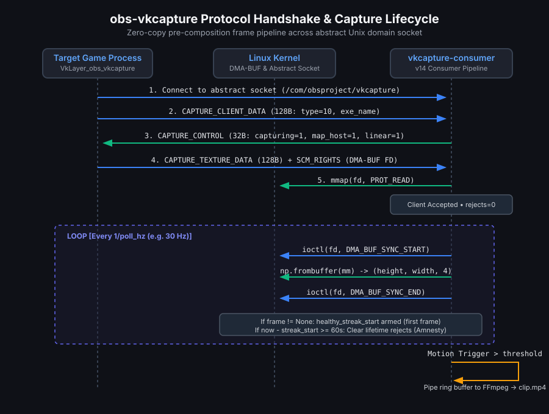

# vkcapture-consumer

Standalone OBS-free consumer for `obs-vkcapture`.

> **WARNING: This tool uses the `obs-vkcapture` wire protocol and requires `libobs_glcapture.so` / `VkLayer_obs_vkcapture` to be active in the target application by launching it with `OBS_VKCAPTURE=1` (or via `obs-gamecapture`). Without the Vulkan/OpenGL capture layer injected into the game process, no frames will be exported over the abstract Unix domain socket.**

---

## Wire Protocol & Handshake Lifecycle



---

## Overview: Pre-Composition DMA-BUF Capture Path

Unlike desktop scrapers (e.g. X11 xshmfence/XGetImage, PipeWire screen portals, or Wayland wlr-export-dmabuf) which capture post-composition desktop surfaces after GPU blending and display-server scaling:

1. **Layer Injection**: `VkLayer_obs_vkcapture` hooks Vulkan swapchain presentation (`vkQueuePresentKHR`) or OpenGL buffer swaps (`glXSwapBuffers` / `eglSwapBuffers`).
2. **Zero-Copy DMA-BUF Export**: The capture layer exports the underlying swapchain texture memory as Linux DMA-BUF file descriptors (`SCM_RIGHTS`) across an abstract Unix domain socket (`/com/obsproject/vkcapture`).
3. **Pre-Composition Direct Memory Mapping**: `vkcapture-consumer` memory-maps the DMA-BUFs directly into userspace via `mmap()` with kernel CPU/GPU cache synchronization (`DMA_BUF_IOCTL_SYNC`), extracting pristine pre-composition game frames before any window compositing, scaling artifacts, or compositor overhead.
4. **Motion-Triggered Circular Buffer**: Incoming frames cycle through an in-memory pre-roll ring buffer; when inter-frame motion exceeds the threshold, the pre-roll and post-trigger frames are written into a standalone MP4 file via FFmpeg.

---

## Installation

### Prerequisites

Ensure `ffmpeg` is installed on your system PATH:

```bash
# Arch Linux
sudo pacman -S ffmpeg

# Ubuntu / Debian
sudo apt install ffmpeg

# Fedora
sudo dnf install ffmpeg
```

### Install Package

Clone the repository and install in editable mode:

```bash
git clone https://github.com/ngesa-cloud/vkcapture-consumer.git
cd vkcapture-consumer
pip install -e .
```

Alternatively, run the automated setup script:

```bash
./scripts/setup.sh
```

---

## Usage

Start the capture consumer in a terminal:

```bash
vkcapture --out ~/clips --clip-len 15
```

Or load a dedicated per-game TOML profile:

```bash
vkcapture --config profiles/gtavi.toml
```

Launch your Vulkan/OpenGL application with the capture layer injected:

```bash
OBS_VKCAPTURE=1 ./your_game
# Or via the obs-gamecapture wrapper:
obs-gamecapture ./your_game
```

### Options

```
usage: vkcapture [-h] [--config CONFIG] [--out OUT] [--exe EXE]
                 [--clip-len CLIP_LEN] [--motion MOTION]
                 [--refractory REFRACTORY] [--poll-hz POLL_HZ]
                 [--connect-timeout CONNECT_TIMEOUT]
                 [--lifetime-cap LIFETIME_CAP] [--reset-window RESET_WINDOW]

options:
  --config CONFIG, -c CONFIG  Path to TOML configuration profile (e.g. profiles/gtavi.toml)
  --out OUT                   Output directory for clips (default: ~/clips)
  --exe EXE                   Optional substring filter for client executable path
  --clip-len CLIP_LEN         Clip duration in seconds (default: 20.0)
  --motion MOTION             Mean pixel motion threshold to trigger clip (default: 0.1)
  --refractory REFRACTORY     Minimum seconds between triggers (default: 15.0)
  --poll-hz POLL_HZ           Target polling/capture frequency in Hz (default: 30.0)
  --connect-timeout TIMEOUT   Handshake deadline in seconds (default: 15.0)
  --lifetime-cap CAP          Cumulative reject ceiling before refusing client (default: 10)
  --reset-window WINDOW       Seconds of unbroken frame delivery to clear rejects (default: 60.0)
```

---

## Testing

Run the protocol integration test suite:

```bash
python3 -m unittest -v tests/test_protocol.py
# Or with pytest:
pytest -v tests/
```
